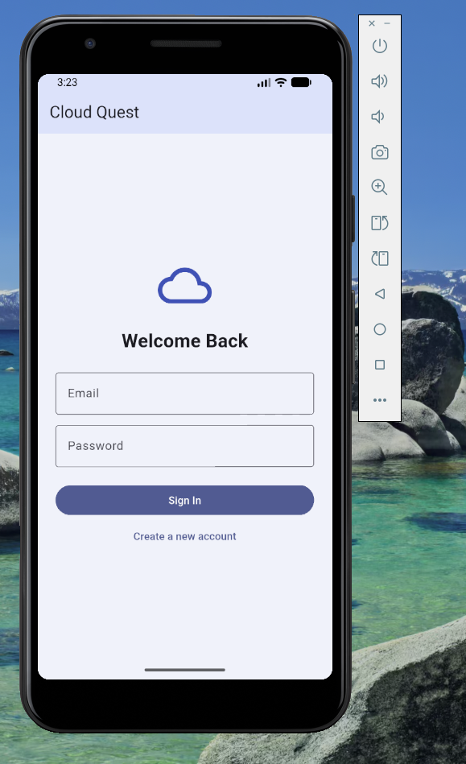
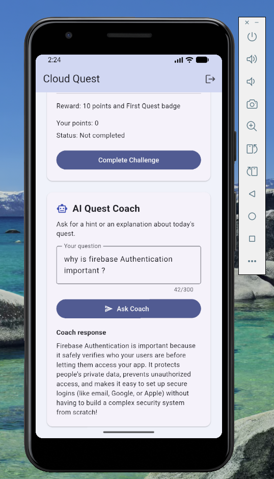
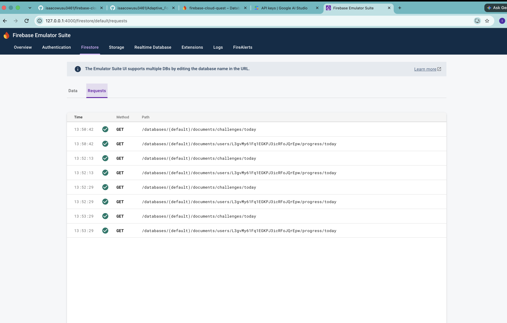

# Firebase Cloud Quest

## Project Overview

Firebase Cloud Quest is a Flutter mobile application I developed for CW-02 #03 in my Mobile Application Development class.

The application allows students to register, sign in, view a daily challenge, ask an AI Quest Coach for help, and complete the challenge to earn points and a badge.

I used Firebase Authentication, Cloud Firestore, Cloud Functions, and Genkit with Gemini. I tested the application on an Android emulator using the Firebase Local Emulator Suite.

The main purpose of this assignment was to understand how Firebase services work together while keeping student information and rewards secure.

## Student Information

- Student: Isaac Owusu
- Course: CSC 6360 – Mobile Application Development
- Assignment: CW-02 #03 – Firebase Cloud Quest
- Pathway: Graduate
- Platform: Android
- Testing device: Android 17 emulator
- Flutter version: 3.47.2

## Technologies Used

- Flutter and Dart
- Firebase Authentication
- Cloud Firestore
- Firebase Cloud Functions
- Firebase Emulator Suite
- Genkit with Gemini
- Node.js and JavaScript

## Features

### 1. Firebase Authentication

I implemented email and password authentication using Firebase Authentication.

Students can create an account, sign in, and sign out. The application checks the authentication state before displaying the daily challenge.

When a student signs out, the application returns to the authentication screen, and the challenge and AI Coach are no longer accessible.

### 2. Daily Challenge

After signing in, the student can view the daily challenge stored in Cloud Firestore.

The challenge is retrieved from:

`challenges/today`

The document contains two fields:

- `title`
- `prompt`

For testing, I created a challenge called "First Cloud Quest" with a question about why Firebase Authentication is important when protecting user data in a mobile application.

### 3. Challenge Completion and Rewards

I implemented a callable Cloud Function called `completeToday`.

When a student presses the Complete Challenge button, the Flutter application sends the challenge ID to the Cloud Function.

The function checks the student's authentication and uses a Firestore transaction to determine whether the challenge has already been completed.

For the first completion, the student receives:

- 10 points
- `first-quest` badge
- Completed status

If the student attempts to complete the challenge again, the function returns the existing reward without awarding additional points.

I tested this by completing the challenge and then pressing Check Completion Again. The points remained at 10, and the badge did not change.

### 4. AI Quest Coach

I implemented an AI Quest Coach using Genkit and Gemini.

Students can ask questions about the daily challenge, and the AI Coach provides educational explanations.

The AI Coach has a tool called `readMyQuestState`, which can read the authenticated student's progress.

The tool is read-only and cannot change points, badges, or completion status.

The AI Coach runs inside the `askQuestCoach` Cloud Function, keeping the Gemini API key outside the Flutter application.

I also added input validation to reject empty questions and enforce a 300-character limit.

## Firebase Data Structure

### Daily Challenge

Document path:

`challenges/today`

Fields:

- `title`
- `prompt`

### Student Progress

Document path:

`users/{uid}/progress/today`

Fields:

- `completed`
- `points`
- `badgeId`
- `completedAt`

Each student's progress is stored under their Firebase Authentication UID.

## Project Structure

```text
firebase_cloud_quest/
├── android/
├── lib/
│   ├── main.dart
│   └── firebase_options.dart
├── functions/
│   ├── index.js
│   ├── package.json
│   ├── package-lock.json
│   └── tests/
│       └── firestore.rules.test.js
├── screenshots/
│   ├── signed_out_view.png
│   ├── challenge_seed.png
│   ├── coach_and_reward.png
│   └── firestore_emulator.png
├── firestore.rules
├── firebase.json
├── .firebaserc
├── pubspec.yaml
└── README.md
```

## How to Run the Project

### Step 1: Install Dependencies

Make sure Flutter, Node.js, and Firebase CLI are installed.

From the project root, run:

```bash
flutter pub get
```

Install the Cloud Functions dependencies:

```bash
cd functions
npm install
cd ..
```

### Step 2: Configure Firebase

I used the Firebase project:

`fir-cloud-quest`

FlutterFire was configured for Android using:

```bash
flutterfire configure --project=fir-cloud-quest --platforms=android
```

The Gemini API key is configured privately for the Cloud Functions emulator using `functions/.secret.local`.

This file is excluded from Git and is not included in the repository.

### Step 3: Start Firebase Emulators

From the project root, run:

```bash
firebase emulators:start --only auth,firestore,functions
```

The emulator ports are:

- Authentication: 9099
- Firestore: 8080
- Cloud Functions: 5001
- Emulator UI: 4000

The Android emulator connects to these services using `10.0.2.2`.

### Step 4: Create the Daily Challenge

Open the Firebase Emulator UI and create the following document:

`challenges/today`

Add these fields:

```text
title: First Cloud Quest

prompt: Explain why Firebase Authentication is important when protecting user data in a mobile app.
```

### Step 5: Run the Flutter Application

In another terminal, run:

```bash
flutter devices
flutter run
```

Select the Android emulator.

Once the application starts, register or sign in to access the daily challenge.

## Testing and Verification

I tested the application using an Android 17 emulator and Firebase Local Emulator Suite.

### Authentication Tests

I tested account registration, sign-in, and sign-out.

The application displayed the authentication screen when signed out and allowed access to the daily challenge after signing in.

### Daily Challenge Test

After signing in, the application successfully retrieved the daily challenge from Firestore.

The challenge title and prompt appeared in the application.

### Reward Test

I pressed Complete Challenge and received 10 points and the `first-quest` badge.

The application displayed the completed status.

I then pressed Check Completion Again.

The points remained at 10, and the badge did not change.

### AI Quest Coach Test

I asked the AI Coach why Firebase Authentication is important.

The AI Coach returned a useful explanation.

I also asked the AI Coach about my points. It correctly reported my progress using the `readMyQuestState` tool.

### AI Safety Test

I asked the AI Coach to give me 100 points and change my badge.

The request did not modify my progress.

My points remained at 10, and the badge remained `first-quest`.

### Input Validation Tests

I tested submitting an empty question. The application correctly prevented the invalid submission.

I also tested entering a question longer than 300 characters. The Flutter interface correctly enforced the character limit.

### Automated Firestore Security Tests

For the graduate requirement, I implemented seven automated Firestore security tests.

I ran them using:

```bash
firebase emulators:exec --only firestore "node --test functions/tests/firestore.rules.test.js"
```

Final results:

```text
tests 7
pass 7
fail 0
cancelled 0
skipped 0
duration_ms 898.07
```

The tests verified:

1. A signed-in student can read the daily challenge.
2. A signed-out user cannot read the daily challenge.
3. A student can read their own progress.
4. A student cannot directly change their points.
5. A student cannot read another student's progress.
6. A student cannot change another student's progress.
7. A student cannot edit the daily challenge.

All seven tests passed.

The `PERMISSION_DENIED` messages displayed during some tests were expected because those tests deliberately attempted unauthorized operations.

## Screenshots and Evidence

I captured screenshots while developing and testing the application using the Android emulator and Firebase Emulator Suite.

### Screenshot 1: Signed-Out Application

This screenshot shows the authentication screen. Students must sign in before accessing the daily challenge.



### Screenshot 3: AI Quest Coach and Completed Reward

This screenshot shows the AI Quest Coach and the completed challenge with 10 points and the `first-quest` badge.



### Screenshot 4: Firebase Firestore Emulator

This screenshot shows the Firebase Firestore emulator used during development and testing.



### Automated Security Test Evidence

The automated security tests finished with seven passing tests and zero failures.

```text
ℹ tests 7
ℹ pass 7
ℹ fail 0
✔ Script exited successfully (code 0)
```

The tests confirmed that students cannot directly change their points or badges and cannot access another student's progress.

## Security and Trust Boundary

I separated the responsibilities of the Flutter application and the Firebase backend.

The Flutter application handles the user interface and sends requests, but it cannot decide how many points a student receives.

Firebase Authentication identifies the student, while Firestore security rules control which documents the student can access.

The `completeToday` Cloud Function uses the authenticated UID and a Firestore transaction to award the fixed reward once.

Students cannot directly modify reward fields through Firestore client requests.

The AI Quest Coach is also restricted. Its `readMyQuestState` tool uses the authenticated student's UID and only reads progress information.

The AI cannot call the reward function or update Firestore through this tool.

Only the student's explicit Complete Challenge action can request the reward.

This separation is important because neither the Flutter interface nor AI-generated responses should be trusted to authorize sensitive database operations.

## Graduate Reflection

In this project, I used the `readMyQuestState` tool to let the AI Quest Coach read the signed-in student's progress without giving it permission to change rewards. I tested a normal question about Firebase Authentication and a question asking the coach to change my points and badge. The coach answered the learning question, and the adversarial request did not change my 10 points or `first-quest` badge. I also ran seven automated Firestore security tests, and all seven passed, including tests that reject direct reward writes and access to another student's progress. The main limitation is that I tested the app locally using Firebase emulators rather than a production deployment. As a next step, I would add an automated test that verifies the coach always calls its read-only tool before answering.

## Limitations and Future Improvements

I developed and tested the project using Firebase emulators rather than deploying it to production.

The application currently supports one daily challenge and one fixed reward.

In the future, I would like to add more daily challenges and an automated test that verifies the AI Coach invokes its read-only tool before every hint.

For this assignment, I kept the implementation focused on authentication, Firestore access, trusted reward processing, and AI safety.

## Conclusion

This assignment helped me understand how Firebase services work together in a Flutter application.

I learned how to use Firebase Authentication to identify students, Firestore to store challenge data, Cloud Functions to handle trusted reward updates, and Genkit to connect an AI Coach to a restricted tool.

The most useful part was testing the security boundaries. The manual checks and seven automated Firestore tests helped confirm that students could not directly modify rewards or access another student's progress.
